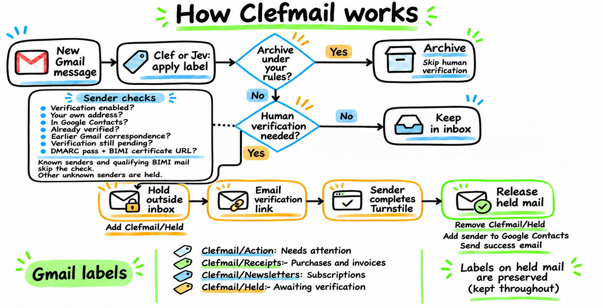

# Clefmail for Google Cloud

Clefmail organizes new Gmail messages as they arrive. It uses Clef or Jev to choose a label from your rules, with optional archiving for mail that needs no inbox attention. You keep using Gmail, where the labels and messages appear.

AI archiving and human verification are enabled by default. Classification and archiving run first. Messages archived under your rules skip human verification. For mail that remains in the inbox, human verification holds mail from unknown senders and emails them a link to confirm they are human. Once they complete the check, their held mail returns to your inbox and they become a Google Contact.

Clefmail is self-hosted on Google Cloud and supports up to ten mailboxes with separate rules. **Ready for production:** deployment and live-mail testing are complete, including sender verification.

## How mail moves through Clefmail



Processing starts with mail received after the first Gmail watch is registered. Clefmail skips Spam, Trash, drafts and sent-only messages. Read mail and messages archived by a Gmail filter remain eligible for labeling. Each update applies to an individual message and preserves its unread status and unrelated labels.

AI archiving defaults to `true`. Set `archiveEnabled: false` for labeling only. Contacts are protected from Clefmail archiving; starred and important messages are also protected from AI archiving. Human verification uses its own `humanVerification` setting, which defaults to `true`.

### Labels in Gmail

The example configuration includes three category labels. You can rename these or define your own in `config.json`.

| Label | What it means |
| --- | --- |
| `Clefmail/Action` | A request or personal message that needs your attention |
| `Clefmail/Receipts` | A purchase confirmation, invoice or transaction record |
| `Clefmail/Newsletters` | A subscription or informational newsletter |
| `Clefmail/Held` | The message is waiting for its sender to complete human verification; removed when the message is released |

A classified message receives at most one configured category label. When the model is uncertain, Clefmail keeps the message's labels and inbox status. Held messages retain their category label and receive `Clefmail/Held`. They have already been classified and keep their labels when released. Clefmail records completed processing in its private Cloud Storage bucket, so tracking adds no label to your mail.

### Human verification

For messages that remain in the inbox after classification and archiving, Clefmail checks Google Contacts, saved verification status and retained Gmail correspondence to decide whether a sender needs verification. Existing contacts and previously verified senders can reach the inbox. Earlier correspondence also bypasses the human check, though AI archiving can still apply to a sender outside your contacts. A plus-tagged reply address is recognized when the reply references a retained sent message to its base address.

Further mail from a sender awaiting verification is classified first. Mail that remains in the inbox joins the hold. Clefmail reuses the pending challenge while its link remains valid. Messages moved to Trash or Spam stay there when verification completes, and mail originally archived by a Gmail filter stays archived.

Automated replies, bulk mail and other messages that could cause reply loops may be held without a challenge. The owner can add a sender to Google Contacts; subsequent processing releases their held mail. See the [human verification guide](docs/VERIFICATION.md) for setup and the full handling rules.

### BIMI and DMARC exemption

A message skips human verification when Gmail reports a DMARC pass for its sender domain and that domain publishes a BIMI record with an HTTPS certificate URL (`a=`). Clefmail uses the message's `BIMI-Selector`, or `default` when absent. It can fall back to the authenticated parent domain reported by Gmail.

This lightweight check reads DNS and caches results for five minutes. It does not download or validate the certificate, or establish whether Gmail displays a blue checkmark. The exemption applies to the individual message, so it creates no contact or permanent sender trust. AI labeling and archiving still run first. A missing record or failed lookup leaves the normal sender checks in place.

### Google Cloud services

The processor accepts authenticated internal requests. The public service handles verification links. Both use the same private state bucket so message processing and verification can coordinate changes to the mailbox. Secret Manager supplies credentials and configuration.

## Before you start

You need:

- A Gmail or Google Workspace mailbox you control. Workspace administrators may restrict OAuth access.
- A **Google Cloud project with billing enabled**. The OAuth client and Gmail watch Pub/Sub topic must belong to the same project.
- Permission to create cloud resources, enable APIs, grant the required IAM roles, and act as deployment service accounts. Cloud Build's build identity must be configured for Cloud Run source deployments; see [Google's source deployment requirements](https://cloud.google.com/run/docs/deploying-source-code).
- A Cloudflare account/token with Workers AI execution permission for **Clef**, or a TypeSafe API key for **Jev**. You do not need a Cloudflare Worker deployment to use Clef.
- [Bun](https://bun.sh/) 1.3.9+, [Node.js](https://nodejs.org/) 22+, Git, Bash, and the [Google Cloud CLI](https://cloud.google.com/sdk/docs/install). Production runs Node 22.
- A browser on the **same machine** as the authorization helper. Its OAuth callback listens on local loopback, not a remote server.

Google Cloud and model inference can incur charges. There is no built-in spending cap; configure cloud billing alerts and provider-side limits. Scale-to-zero does not mean every component is free.

## 1. Clone and check the project

```bash
git clone https://github.com/dctanner/clefmail-gcloud.git
cd clefmail-gcloud
bun install --frozen-lockfile
bun run check:full
```

This runs TypeScript checks, synthetic tests, and the build. **It does not deploy resources, call real models, or access Gmail.**

Create your private local configuration:

```bash
cp config.example.json config.json
cp .env.example .env
chmod 600 config.json .env
```

These files and `.secrets/` are ignored by Git and excluded from cloud build uploads. Never commit tokens, downloaded OAuth credentials, personal configuration, or real mail samples.

## 2. Configure your mailbox and model

Edit `config.json`:

1. Set `accounts[0].email` to your actual Gmail/Workspace mailbox address, not an unrelated sending alias.
2. Leave its ID as `personal` and `refreshTokenEnv` as `GMAIL_PERSONAL_REFRESH_TOKEN` for the commands below.
3. Set `archiveEnabled` to match your policy: `true` allows eligible messages to be archived; `false` keeps AI processing to labeling.
4. Customize the prompt and label descriptions. Labels are Gmail label names, such as `Clefmail/Action`; the short `id` fields are internal classification choices, not Gmail's generated label IDs.
5. Choose exactly one provider for the deployment:

**Clef through Cloudflare Workers AI REST:**

```json
"provider": {
  "kind": "clef",
  "accountId": "YOUR_32_CHARACTER_LOWERCASE_HEX_ACCOUNT_ID"
}
```

Replace the placeholder with your real Cloudflare account ID. Put the corresponding Workers AI API token in `.env` as `CLASSIFIER_API_KEY`.

**Jev through TypeSafe's System One API:**

```json
"provider": {
  "kind": "jev",
  "model": "jev-latest"
}
```

Put your TypeSafe API key in `.env` as `CLASSIFIER_API_KEY`. Prefer a pinned, available Jev version for predictable behavior. There is no cross-provider fallback and no Vercel AI Gateway dependency.

Other optional account settings:

| Setting | Default | Meaning |
| --- | --- | --- |
| `enabled` | `true` | Whether to process and renew watches for this mailbox |
| `archiveEnabled` | `true` | Allow the AI classifier to archive eligible messages (contacts are always protected) |
| `humanVerification` | `true` | Independently quarantine new unknown senders until verified; requires verification service configuration |
| `probability` | `0.75` | Minimum category probability |
| `margin` | `0.15` | Minimum margin over the runner-up category |
| `archiveThreshold` | `0.95` | Minimum archive probability |

These thresholds are starting points, **not accuracy guarantees**. Each account supports 1–20 labels. Keep prompts free of credentials and unrelated private information.

## 3. Create Google OAuth credentials

1. Open your project in [Google Cloud Console](https://console.cloud.google.com/).
2. Under **APIs & Services → Library**, enable the **Gmail API** and **People API**.
3. Open **Google Auth Platform** (or the OAuth consent screen). Configure app branding/contact details and the appropriate audience. A personal Gmail account normally requires an external audience; internal apps are limited to an eligible Workspace organization.
4. If the app is in **Testing**, add your mailbox under test users.
5. Configure `https://www.googleapis.com/auth/gmail.modify` and `https://www.googleapis.com/auth/contacts` under data access. Contacts access is required even when human verification is disabled, so the AI archiver can protect existing contacts. Existing installations must reauthorize and publish a new token version before upgrading.
6. Create an OAuth client with application type **Desktop app**. The helper uses a dynamic loopback callback; do not create a Web application client for this walkthrough.
7. Privately copy the client ID and client secret into `.env` as `GOOGLE_CLIENT_ID` and `GOOGLE_CLIENT_SECRET`. Keep `CONFIG_PATH=./config.json`.

`gmail.modify` is a restricted scope and permits more than this program uses. External apps in Testing generally receive refresh tokens that expire after seven days for this scope. Choose an appropriate personal/internal or verified production publishing path before relying on unattended operation. Self-hosting is not a blanket exemption from Google policies, and a Cloud Run service account cannot replace mailbox OAuth authorization.

See [OAuth loopback flows](https://developers.google.com/identity/protocols/oauth2/native-app#redirect-uri_loopback) and [refresh-token expiration](https://developers.google.com/identity/protocols/oauth2#expiration).

## 4. Authorize Gmail and create the labels

Run this **on the computer where you will open the browser**:

```bash
bun run authorize personal
```

Open the printed Google URL, select the configured mailbox, and approve both requested scopes. Do not share the authorization URL. The helper checks OAuth state, PKCE, mailbox identity and scope, then saves the refresh token to `.secrets/personal.token` with owner-only permissions. It does not print the token and will not overwrite an existing file.

Load the token into your current Bash session and create missing labels:

```bash
export GMAIL_PERSONAL_REFRESH_TOKEN="$(<.secrets/personal.token)"
bun run setup
```

`setup` verifies the mailbox and creates the configured category labels and `Clefmail/Held`. **It does not read message bodies, classify messages, or start a watch.** The runtime only looks up labels; rerun setup if you deliberately change the label configuration.

Bun loads `.env` automatically for local tools; Bash and `gcloud` do not. The exported token above takes precedence over the placeholder in `.env`. Do not use shell tracing (`set -x`) while handling credentials.

### Optional: preview a model decision

```bash
bun run preview personal /absolute/path/to/synthetic-sample.txt
```

This sends the supplied plain-text file to the selected model and prints a decision. It never accesses or changes Gmail, but it **does make a billable provider request** and sends the sample text outside your machine. Start with a synthetic sample. This is not a background Gmail dry-run mode.

## 5. Store production secrets

Authenticate the Google Cloud CLI and choose your project, region and a **globally unique, dedicated** bucket name:

```bash
gcloud auth login
export PROJECT=your-google-project-id
export REGION=us-central1
export STATE_BUCKET=your-project-clefmail-state

gcloud --project="$PROJECT" services enable \
  secretmanager.googleapis.com gmail.googleapis.com people.googleapis.com
```

Production reads a pinned copy of `config.json` from Secret Manager. It does not read your local `.env`.

Create the configuration and mailbox-token secrets:

```bash
gcloud --project="$PROJECT" secrets create clefmail-config \
  --replication-policy=automatic --data-file=config.json
gcloud --project="$PROJECT" secrets create clefmail-personal-token \
  --replication-policy=automatic --data-file=.secrets/personal.token
```

In your **private Bash terminal**, enter the same client ID, client secret and model key you used in `.env`. These prompts hide input and avoid putting secret literals in shell history:

```bash
read -rsp 'Google OAuth client ID: ' GOOGLE_CLIENT_ID; printf '\n'
read -rsp 'Google OAuth client secret: ' GOOGLE_CLIENT_SECRET; printf '\n'
read -rsp 'Classifier API key: ' CLASSIFIER_API_KEY; printf '\n'

printf '%s' "$GOOGLE_CLIENT_ID" | gcloud --project="$PROJECT" secrets create \
  clefmail-google-client-id --replication-policy=automatic --data-file=-
printf '%s' "$GOOGLE_CLIENT_SECRET" | gcloud --project="$PROJECT" secrets create \
  clefmail-google-client-secret --replication-policy=automatic --data-file=-
printf '%s' "$CLASSIFIER_API_KEY" | gcloud --project="$PROJECT" secrets create \
  clefmail-classifier-key --replication-policy=automatic --data-file=-
unset GOOGLE_CLIENT_ID GOOGLE_CLIENT_SECRET CLASSIFIER_API_KEY
```

The commands above are for **initial creation**. If a secret already exists, inspect it and use `gcloud secrets versions add` with the appropriate `--data-file` instead. Do not delete working secrets to repeat the walkthrough. Record new version numbers for deployment; never paste secret values into `SECRET_BINDINGS`.

## 6. Deploy and start processing

Complete the [verification service setup](docs/VERIFICATION.md#deployment-sequence) before enabling processing with the default configuration. Set the real verification URL and Turnstile site key in `config.json`. For initial provisioning, temporarily set `humanVerification: false` until the public service is ready, then enable it on both services.

Use the uploaded configuration version that contains your chosen mailbox and archiving settings.

For freshly created secrets, the initial version is `1`:

```bash
export SECRET_BINDINGS='/secrets/config.json=clefmail-config:1,GOOGLE_CLIENT_ID=clefmail-google-client-id:1,GOOGLE_CLIENT_SECRET=clefmail-google-client-secret:1,CLASSIFIER_API_KEY=clefmail-classifier-key:1,GMAIL_PERSONAL_REFRESH_TOKEN=clefmail-personal-token:1'
bash scripts/deploy.sh
```

**This creates billable resources and starts processing new eligible mail.** The script:

- Runs all local checks, then enables the required Google APIs.
- Creates the Cloud Run service (`clefmail-gcloud` by default), runtime/invoker service accounts, private checkpoint bucket, Pub/Sub topics/subscriptions, diagnostic dead-letter subscription, and one daily watch-renewal Scheduler job.
- Grants the runtime object access to the dedicated bucket and access to only the referenced secrets.
- Grants Gmail's publisher permission on the notification topic.
- Deploys from source with scale-to-zero, one maximum instance, concurrency 1, and 300-second request/ACK deadlines. A conditional storage lease also protects overlapping retries/rollouts.
- Uses authenticated push/Scheduler requests, private Cloud Run IAM and `--ingress=internal`.
- Triggers the daily Scheduler job once to establish initial Gmail watches.

Cloud Build permissions and organization policies may require administrator setup. The script does not configure billing alerts or notification channels. A failed deployment can leave partially created resources; inspect the failure before retrying.

Do **not** grant `allUsers` or `allAuthenticatedUsers` access or put an unauthenticated proxy in front of the **processor** service. Human verification uses a separately deployed public service in `SERVICE_MODE=verification`, which has no `/pubsub` or `/renew` routes; see [the verification guide](docs/VERIFICATION.md). Both trusted invoker identities can invoke both POST routes; there is no separate application login. The Cloud Run URL is not a dashboard and direct internet requests should be rejected.

## 7. Monitor production

Read recent service logs:

```bash
gcloud --project="$PROJECT" run services logs read clefmail-gcloud \
  --region="$REGION" --limit=50
```

Successful `watch_renewed` events record Gmail watch renewal for each mailbox. Cloud Logging and Pub/Sub/Scheduler metrics show processing failures and delivery delays. Useful alerts include Scheduler failure, `request_failed`, `history_gap_dropped`, `lease_release_failed`, and a growing dead-letter backlog.

Held messages appear under `Clefmail/Held` in Gmail. Successful sender verification removes that label and restores messages that originally arrived in the inbox.

## Operating your deployment

### Change policy, pause, or add another mailbox

- **Policy/labels:** edit `config.json`, run `bun run setup` if new labels are needed, upload a new config secret version, update `SECRET_BINDINGS`, and redeploy. Already processed messages are not automatically reclassified. Prefer changes while idle to avoid old-policy decisions already in flight.
- **Stop archiving:** set `archiveEnabled: false` and `humanVerification: false` and redeploy the new config version. Labeling continues. Disabling verification does not automatically restore held mail; see the verification guide for how to drain it first.
- **Pause a mailbox:** set `enabled: false` and redeploy. This is not an instantaneous cancellation of an already running request.
- **Add a mailbox:** add a unique account ID, actual mailbox address and `GMAIL_..._REFRESH_TOKEN` environment name. Authorize it with `bun run authorize <id>`, export that token, and run setup. Create a separate token secret, add its binding, upload the revised config and redeploy. Add it as an OAuth test user if necessary. All mailboxes share the selected model provider.
- **Reconnect:** move the old `.secrets/<id>.token` aside privately before rerunning authorization. Publish a new token secret version and update its binding. Do not commit either token file.
- **Disconnect:** disable the account and redeploy, revoke the app's Google grant, then remove its token secret/checkpoint when appropriate. Watches expire within seven days without renewal. Do not delete checkpoints as a routine repair: that deliberately loses intervening history.

### Troubleshooting

| Symptom | What to check |
| --- | --- |
| OAuth access blocked | Correct project/audience, configured test user, Workspace administrator policy, and restricted-scope requirements |
| Browser cannot reach OAuth callback | Run the helper and browser on the same machine; its loopback listener expires after five minutes |
| `mailbox_identity_mismatch` | Authorize the primary mailbox address configured in `config.json` |
| Authorization refuses to save | The token file already exists; move it aside privately only if reconnecting |
| Token works, then expires after about a week | External OAuth app is still in Testing; review Google's publishing/token rules |
| Cloud Run source build fails | Deployment identity, Cloud Build service account permissions, billing and source-deployment prerequisites |
| Gmail watch registration fails | Gmail API enabled, OAuth client/topic in the same project, Gmail publisher allowed on the topic, organization IAM policies |
| No messages processed | Successful watch initialization, genuinely new mail, account enabled, valid token/model key, existing labels, Pub/Sub delivery/logs |
| `history_gap_dropped` | Cursor expired; the service resets to the current baseline and does not recover missed mail |
| Dead-letter backlog | Inspect sanitized logs and fix the cause; dead letters are diagnostic, not automatic recovery |

### Stop using it

Disable processing and revoke Gmail grants first. Then remove the dedicated Scheduler job, Pub/Sub subscriptions/topics, Cloud Run service, bucket, secrets and service accounts when no longer needed. Source deployment can also leave build artifacts/images in Artifact Registry. Inspect resources before deleting anything; deleting a checkpoint removes recovery context. There is no automatic teardown command.

## Safety, privacy and deliberate limits

- **Message-level only:** classification adds a category and may remove `INBOX`. Optional verification sends challenge/confirmation emails, creates contacts, and restores only messages recorded as having been in the inbox before quarantine. It never deletes, trashes, marks read, or modifies a whole thread. Unread status and unrelated labels are preserved.
- **AI archive guardrails:** contacts, the mailbox's own address, and ambiguous/missing senders are protected. Contacts API failures retry instead of permitting an archive. A usable, untruncated plain-text body and valid confident category are required. Freshly checked starred, important, Spam, Trash and draft messages cannot be archived. Header-only classification requires at least 0.90 probability and cannot archive. Invalid archive output means label-only; invalid/abstaining category decisions are recorded privately. Opt-in human-verification quarantine is independent of these AI thresholds and starred/important protection; Spam, Trash and drafts remain excluded.
- **Text only:** no attachments, HTML conversion, external images, linked-page fetching or conversation history. Email text exists in request memory and goes to the selected provider. Logs contain opaque message/account IDs and outcome codes, not subjects or bodies.
- **Persistent state:** Secret Manager holds credentials/configuration, Pub/Sub holds mailbox/history metadata, Storage holds cursors/watch expiry/leases and optional sender records (email address, secret verification capability, pending message IDs and completion state), and private per-message completion records prevent repeated processing. Treat the private bucket as sensitive mailbox data; there is no automatic sender-record expiration or deletion.
- **At-least-once, not exactly-once:** crashes can repeat inference and its cost. Processing markers usually prevent repeated completed work. Verification also journals pending messages and completion stages; deterministic Message-IDs and Sent searches reduce duplicate notices, but Gmail send/contact creation is not transactional and ambiguous failures can still duplicate external effects. Removing those markers can permit reprocessing if history is replayed.
- **No historical recovery:** an expired history cursor is reset to the current baseline; missed mail is not recovered. A failed message can delay subsequent history until retry; notifications can eventually dead-letter. No automatic dead-letter replay, inbox scan, reconciliation job or backfill is provided.
- **Concurrent edits:** Gmail offers no conditional label transaction. A small race with your manual Gmail changes remains unavoidable.
- **Provider policies:** review the selected model provider's retention/processing terms and Google's Limited Use requirements. No blanket zero-retention, compliance or accuracy claim is made.

## Development

```bash
bun run check       # TypeScript only
bun run test        # synthetic tests; no real external API calls
bun run build       # compile TypeScript into dist/
bun run check:full  # all three
```

`bun run dev` starts the loopback-only local HTTP service, but it is **not an offline demo**: server routes require configured credentials/cloud state and can perform real work. Prefer the synthetic tests for local development. The production container listens on Cloud Run's required interface.

| Path | Purpose |
| --- | --- |
| `src/classifier.ts`, `src/decision.ts` | Clef/Jev adapters, validation and archive policy |
| `src/gmail.ts`, `src/text.ts` | Gmail API access and bounded MIME/text extraction |
| `src/processor.ts`, `src/state.ts` | History processing, watch renewal and storage leases |
| `src/handler.ts`, `src/server.ts` | Private Pub/Sub/renewal endpoints and isolated public service mode |
| `src/verification.ts`, `src/verification-handler.ts`, `src/sender.ts` | Sender quarantine state, Turnstile page/validation, completion and sender parsing |
| `scripts/` | OAuth, label setup, sample preview and explicit deployment |
| `tests/` | Synthetic provider, processing, storage and deployment tests |

## Provider documentation

- [Gmail push notifications and watch renewal](https://developers.google.com/workspace/gmail/api/guides/push)
- [Gmail history synchronization](https://developers.google.com/workspace/gmail/api/guides/sync)
- [Gmail scopes](https://developers.google.com/workspace/gmail/api/auth/scopes)
- [Google API Services User Data Policy](https://developers.google.com/terms/api-services-user-data-policy)
- [Authenticated Pub/Sub push](https://cloud.google.com/pubsub/docs/authenticate-push-subscriptions)
- [Cloud Run source deployments](https://cloud.google.com/run/docs/deploying-source-code)
- [Clef model and REST API](https://developers.cloudflare.com/workers-ai/models/clef/)
- [Cloudflare Workers AI data usage](https://developers.cloudflare.com/workers-ai/platform/data-usage/)
- [Jev System One API](https://docs.typesafe.ai/api/system-one)
